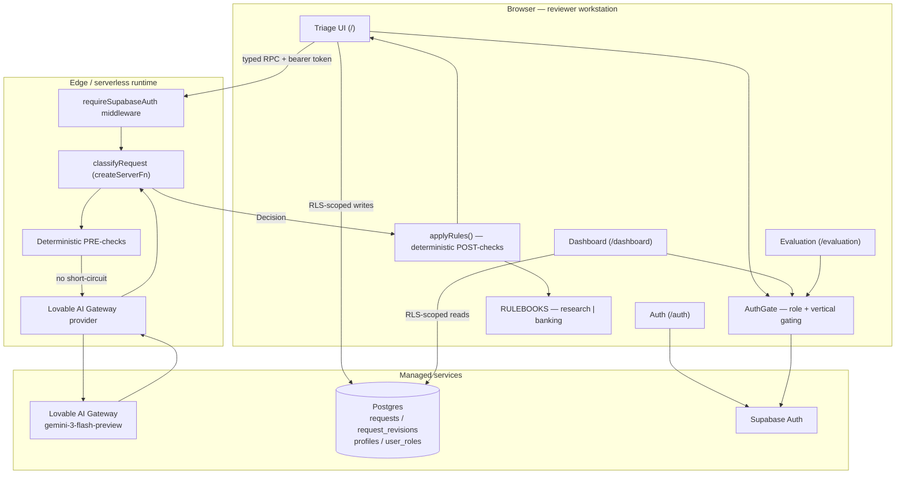
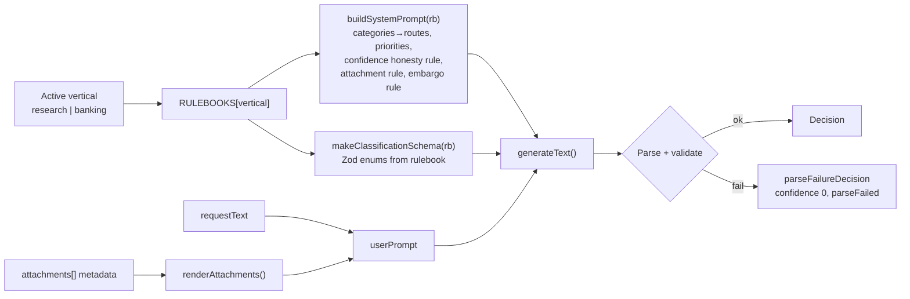
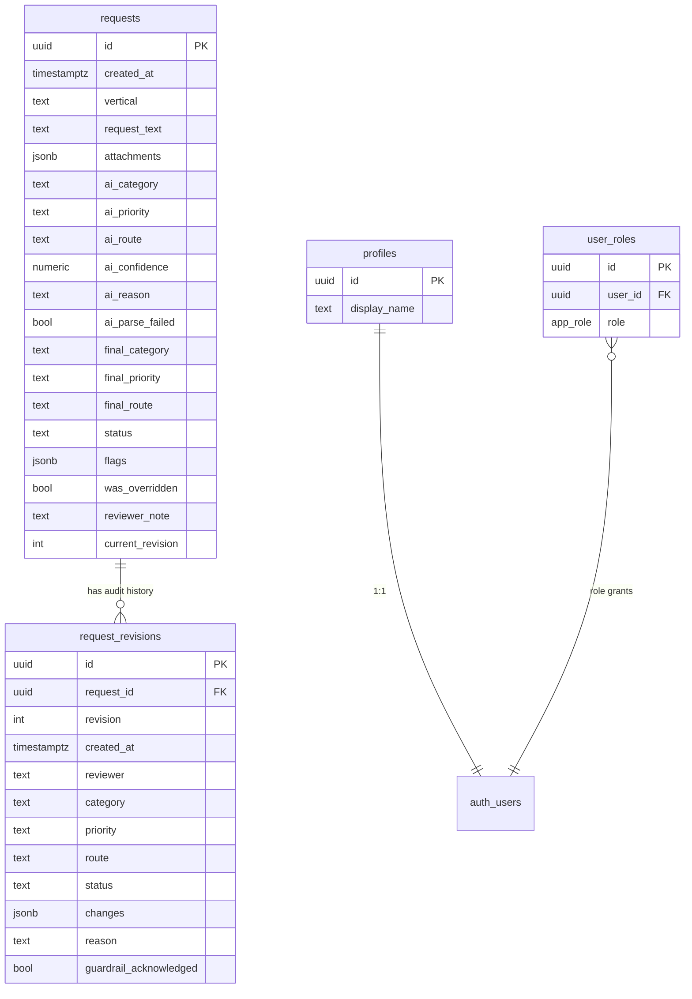
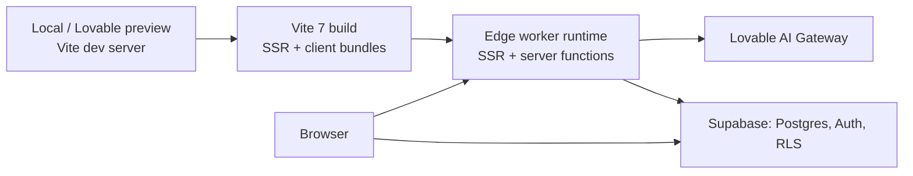

# Technical Architecture

This document describes the system **as built**. Every technical choice is paired with the product reason behind it, because in an AI product the architecture *is* the safety story: where a decision is computed determines whether it can be trusted, audited, and reversed.

---

## 1. Stack Overview

| Layer | Technology | Product reason |
|-------|------------|----------------|
| Framework | TanStack Start (React 19, Vite 7, SSR + server functions) | One codebase holds both the reviewer UI and the trusted server boundary. Triage is a *human workflow*, so the UI is the product — but the model call must never run in the browser. Server functions give a typed RPC boundary without standing up a separate API service. |
| Language | TypeScript (strict) | The rulebook, categories, priorities, and routes are types. A hallucinated or renamed category fails to compile before it can fail in production. |
| Styling | Tailwind CSS v4, semantic tokens in `src/styles.css` | Reviewers scan dozens of decisions per session. Semantic tokens (not hardcoded colors) let the same status/severity language render correctly in light and dark mode without duplicating logic. |
| Data + Auth | Supabase (Postgres + Auth + RLS) | Triage decisions are an audit record. Postgres gives durable, queryable, append-only history; RLS enforces role rules in the database, so a client bug cannot become a privilege bug. |
| AI | Lovable AI Gateway → `google/gemini-3-flash-preview` | Classification of short text is a cheap, latency-sensitive task. A fast model keeps per-request cost and wait time low; accuracy risk is absorbed by deterministic guardrails, not by buying a bigger model. |
| AI SDK | `ai` + `@ai-sdk/openai-compatible`, `Output.object` with a Zod schema | Structured output means the model returns a *typed object*, not prose to be regex-parsed. Fewer parse failures, and the failures that remain are explicit. |
| Charts | Recharts | Operational metrics (escalation rate, override rate, confidence) must be readable by non-technical stakeholders on the same page they review work. |
| Notifications | Sonner | Async triage needs non-blocking feedback; a modal per save would destroy reviewer throughput. |

---

## 2. System Architecture



**Product reason for this shape.** The model sits in the *middle* of the pipeline, never at either end. Deterministic code decides what reaches the model (pre-checks) and what the model's answer is allowed to become (post-checks). That is the "guardrail sandwich": the riskiest outcomes — a privacy breach, a fraud report, restricted-data access without approval — are reachable by pattern-matching alone, so they survive a model outage, a bad prompt, or a confidently wrong answer.

---

## 3. Data Flow — one request, end to end

```mermaid
sequenceDiagram
  autonumber
  participant R as Reviewer (agent)
  participant UI as Triage UI
  participant SF as classifyRequest (server)
  participant M as Gemini 3 Flash
  participant AR as applyRules (client)
  participant DB as Postgres

  R->>UI: paste request text + attach mock files
  UI->>SF: { requestText, attachments[meta], vertical } + bearer token
  SF->>SF: requireSupabaseAuth → has_role(uid,'agent')
  SF->>SF: PRE-CHECK: privacy / fraud patterns?
  alt Pre-check hit (privacy or fraud)
    SF-->>UI: Decision(urgent, confidence 1, "model skipped")
    Note over SF,M: Model is never called — safety path is deterministic
  else Normal path
    SF->>M: system prompt (rulebook) + user prompt (text + attachment metadata)
    M-->>SF: structured JSON {category, priority, reason, confidence}
    SF->>SF: validate category ∈ rulebook; derive route from rulebook
    alt Invalid / unparseable
      SF-->>UI: parseFailureDecision(confidence 0, parseFailed)
    else Valid
      SF-->>UI: Decision
    end
  end
  UI->>AR: applyRules(decision, requestText, attachments)
  AR-->>UI: status + flags (confidence gate, guardrails A/B/C, attachments, embargo)
  UI-->>R: Decision Card (draft — not yet a decision of record)
  R->>UI: Accept / Override (+ reason, guardrail acknowledgment)
  UI->>DB: INSERT requests row + request_revisions v1
  DB-->>UI: persisted; queue re-reads and merges
```

**Product reason.** The model's answer is a **draft**, not an outcome. Nothing is written to the queue until a human finalizes it, so the database contains reviewed decisions and their provenance rather than raw model output. That distinction is what makes the queue usable as an audit trail.

---

## 4. Model Interaction

**Where it runs.** Only inside `classifyRequest`'s handler in `src/lib/classify-request.functions.ts`. `LOVABLE_API_KEY` is read from `process.env` *inside* the handler and never crosses to the browser.

**How the model is constrained:**

1. **Schema-bound output.** `Output.object({ schema })` where `category` and `priority` are Zod enums built from the *active rulebook*. The model cannot return a category the product does not have.
2. **Route is never model-chosen.** The model picks a category; the route is looked up as `rulebook.routes[category]`. *Product reason:* routing is an org policy decision, not a language decision. Reorganizing a team should be a config edit, not a prompt rewrite.
3. **Confidence is requested honestly.** The prompt explicitly instructs the model to return ≤ 0.6 when ambiguous, and states that a humble low-confidence answer is better than a confident wrong one — because a human reviews the low-confidence path.
4. **Attachments are metadata only.** Filename, MIME type, and size are sent; file bytes are never read or uploaded. The prompt tells the model not to claim it read them. *Product reason:* intake attachments frequently contain PII/PHI; sending contents to a third-party model would be a privacy change we have not made.
5. **No safety logic in the prompt.** Embargo rules, approval requirements, and escalation are enforced in code downstream. *Product reason:* a prompt is not an enforcement mechanism — it can be talked out of a rule; a `if` statement cannot.

**Model choice reason.** `gemini-3-flash-preview` was selected for latency and cost on a high-volume, low-complexity classification task. The architecture deliberately makes model capability *substitutable*: swapping the model id changes accuracy and cost, but changes nothing about safety behavior.

---

## 5. Prompt Flow



The system prompt is **generated from the rulebook**, not hand-written per vertical. *Product reason:* adding a vertical (banking complaints was the proof) means adding a config object — categories, routes, priorities, guardrail triggers — and the prompt, the output schema, and the validation all follow automatically. This is what makes the product a *platform* rather than one hard-coded workflow.

---

## 6. APIs

There are no public REST endpoints. All server access is typed RPC via TanStack `createServerFn`.

| Surface | Kind | Auth | Notes |
|---|---|---|---|
| `classifyRequest` | Server function (POST) | `requireSupabaseAuth` + explicit `has_role(uid,'agent')` check | The only path to the model. Input validated by Zod (`requestText` ≤ 8000 chars, ≤ 50 attachments, vertical enum). |
| `requests` / `request_revisions` | Supabase PostgREST from the browser | User session JWT + RLS | Reads open to authenticated; inserts/updates require the `agent` role via RLS policy. |
| `profiles`, `user_roles` | Supabase PostgREST | RLS | `user_roles` is readable only for one's own row; role checks in policies go through the security-definer `has_role()`. |

**Product reason for no public API.** The product's guarantee is "no decision reaches a routing queue without passing the guardrails and a human." A public classification endpoint would let a caller bypass `applyRules` entirely and receive raw model output — which is exactly the failure mode the design exists to prevent.

**Authorization is defense-in-depth:** middleware proves *who you are*, the in-handler `has_role` RPC proves *what you may do*, and RLS re-proves both at the database. A bug in any one layer is not sufficient to write a decision.

---

## 7. Storage



Key storage decisions and their product reasons:

- **AI fields and final fields are stored side by side.** `ai_*` columns are never overwritten by a reviewer. *Product reason:* the override rate — the gap between what the model proposed and what a human shipped — is the single most useful quality signal, and it only exists if both values survive.
- **`request_revisions` is append-only** (`DELETE` and `UPDATE` are denied by RLS; only `INSERT` for agents). *Product reason:* an audit log that can be edited is not an audit log. Corrections append v2, v3 rather than rewriting v1.
- **`changes` is a `jsonb` diff, plus a mandatory `reason` on overrides and a `guardrail_acknowledged` boolean.** *Product reason:* an auditor needs to see not just that a safety escalation was bypassed, but that a named reviewer knowingly bypassed it and said why.
- **One queue row per request, history nested inside.** The UI collapses revisions into a single row with an expandable timeline. *Product reason:* an earlier build showed every version as its own row and reviewers found the queue unreadable — history is context, not workload.
- **`vertical` on every row.** All reads, stats, and the viewer dashboard filter by the active vertical. *Product reason:* research and banking are different operating teams; mixing their queues would be an information leak and a usability failure.
- **Roles live in `user_roles`, never on `profiles`.** *Product reason:* a role column on a user-editable profile row is a privilege-escalation vulnerability.

---

## 8. Infrastructure & Deployment



- **Edge/serverless worker runtime.** No servers to operate; triage traffic is bursty (batch of 12 fixtures, then idle), so per-request scaling matches the workload. *Product reason:* an internal tool should not carry fixed infrastructure cost.
- **Managed Postgres + Auth.** Buying auth, RLS, and durable storage rather than building them kept delivery focused on the guardrail logic, which is the actual product differentiator.
- **Gateway-mediated model access.** No provider key management, and swapping models is a one-line change — important because the model is explicitly treated as a replaceable component.
- **Environment split.** Browser reads `VITE_SUPABASE_URL` / `VITE_SUPABASE_PUBLISHABLE_KEY`; server reads `SUPABASE_URL`, `SUPABASE_PUBLISHABLE_KEY`, and `LOVABLE_API_KEY` inside handlers only.
- **Config-only rollout for new verticals.** Shipping a new domain requires no deployment topology change.

**Known operational gap (documented, not hidden):** batch triage runs sequentially in the browser tab, so closing the tab mid-batch loses un-finalized drafts. A durable server-side job queue is roadmap work, not current behavior.

---

## 9. Security Considerations

| Concern | Control in place | Product reason |
|---|---|---|
| Model key exposure | `LOVABLE_API_KEY` read only inside the server-function handler; `ai-gateway.server.ts` is server-only and never imported by client code | A leaked gateway key is a direct financial and abuse liability. |
| Unauthenticated classification | `requireSupabaseAuth` middleware on `classifyRequest` | Prevents the model endpoint from becoming a free public inference proxy. |
| Privilege escalation | Roles in a separate `user_roles` table; security-definer `has_role()`; explicit role check inside the handler; RLS write policies gated on `has_role(auth.uid(),'agent')` | Viewers must be structurally unable to write decisions, not merely have the buttons hidden. |
| Client tampering | RLS is the authority; hiding UI controls is convenience only. `request_revisions` denies `UPDATE`/`DELETE` to everyone | A determined browser user cannot forge or erase audit history. |
| Injection into the prompt | Request text is passed as user content inside delimiters, never concatenated into the system prompt; the output schema is a closed enum, so a successful injection still cannot produce an out-of-rulebook category or route | Prompt injection degrades to a *wrong category*, which the confidence gate and human review already handle — not to an arbitrary action. |
| PII / PHI exposure to the model | File contents are never read or transmitted; only filename, MIME type, and size | Keeps the largest privacy surface out of scope entirely. |
| Silent unsafe autoroute | Deterministic pre-checks short-circuit privacy/fraud patterns before the model; post-checks re-escalate on low confidence, missing approval, missing attachments, and undated embargoes; parse failures fail *closed* to Human Review with confidence 0 | Every failure mode of the model resolves toward a human, never toward an unattended route. |
| Input abuse | Zod validation caps request text at 8000 chars and attachments at 50 | Bounds cost and blast radius per call. |

**Residual risks worth naming:** request text is stored unredacted in Postgres; there is no rate limit on `classifyRequest` beyond authentication; and the pre-check patterns are English keyword lists that will miss paraphrase. These are tracked in `Risk-Analysis.md` and `Roadmap.md` rather than being asserted as solved.

---

## 10. Route & Component Map

| Path | Role access | Purpose |
|---|---|---|
| `/auth` | public | Sign in / sign up. New accounts default to `viewer`. |
| `/` | agent (full) / viewer (read-only dashboard) | Two-panel triage: input + Decision Card, and the Queue tab with filters and sorting. |
| `/dashboard` | authenticated | KPIs, volume, routing mix, escalation breakdown (Recharts). |
| `/evaluation` | agent only | CSV labeled test set → routing accuracy, confusion matrix, escalation recall. |

Cross-cutting modules: `AuthGate.tsx` (session + role + vertical gating), `AccountMenu.tsx`, `rulebook.ts` (both verticals), `apply-rules.ts` (post-checks), `embargo.ts` (date parsing), `attachments.ts`, `queue-db.ts` (persistence + flattening), `queue-types.ts`.

`mock-classify.ts` remains in the tree as the Tier 1 deterministic classifier and as the `Decision` type source; the live path uses the server function.
